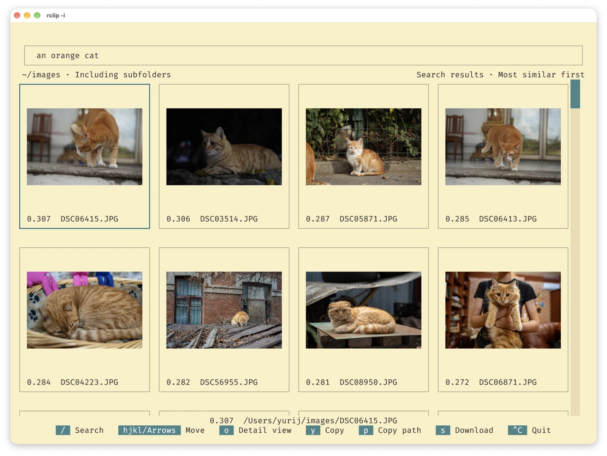
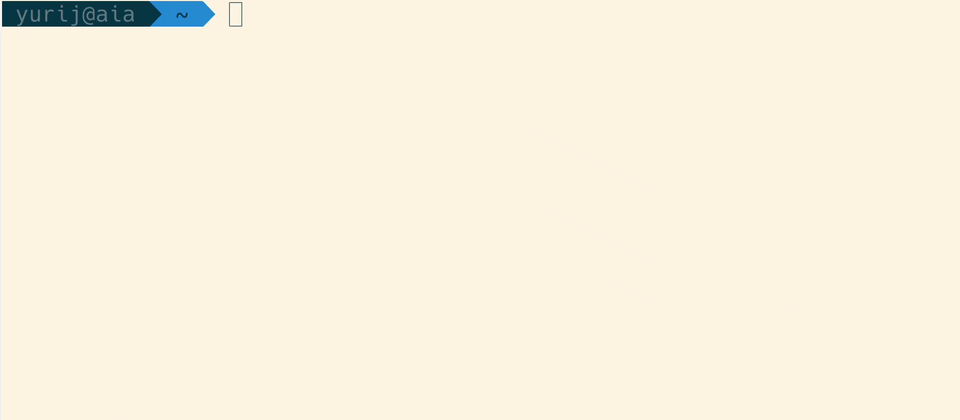

# rclip – grep for images

[[Blog]](https://mikhalevi.ch/rclip-an-ai-powered-command-line-photo-search-tool/) [[Demo on YouTube]](https://www.youtube.com/watch?v=tAJHXOkHidw) [[Paper]](https://www.thinkmind.org/index.php?view=article&articleid=content_2023_1_20_60011)

Search any folder by what its images contain. Use natural language, an example image, or both – without tagging, uploading, or importing your files into a photo library.

**Local. Terminal-native. Works over SSH. Plays well with Unix tools.**

```bash
cd ~/images
rclip "an orange cat"
# score  filepath
# 0.307  "/Users/me/images/DSC06415.JPG"
# 0.306  "/Users/me/images/DSC03514.JPG"
# 0.287  "/Users/me/images/DSC05871.JPG"
```



<sub>`rclip -i`. The interactive UI needs Kitty, Ghostty, or latest iTerm2; previews (`-p`) also work in Konsole. Search and scripting work in any terminal.</sub>

## Features

- **Natural-language search** – find photos by describing them, e.g. `rclip "two parrots on a branch"`.
- **Reverse / image-to-image search** – search by an example image from a local path or a URL.
- **Combined & arithmetic queries** – mix and weight text and image queries, e.g. `rclip "2:golden retriever" + "./pool.jpg" - fruit`.
- **Local & private** – works fully offline; your photos never leave your computer.
- **Wide format support** – `jpg`, `png`, `webp`, `tiff`, `gif`, and more, plus native HEIC on
  macOS/Windows and experimental RAW (`arw`, `cr2`, `dng`).
- **Fast incremental indexing** – only new and changed images are reprocessed on subsequent runs.
- **Interactive terminal UI** – search a responsive thumbnail grid without leaving the terminal.
- **Terminal previews** – view results inline in terminals supporting Kitty graphics.
- **Scriptable** – pipe filepaths to other tools with `-f` or `-0`, or get JSON results for scripts and AI agents with `--json`.
- **Cross-platform** – Linux, macOS (Apple Silicon), and Windows.

## Installation

### Linux

```bash
sudo snap install rclip
```

<details>
  <summary>Alternative options (AppImage and <code>pip</code>)</summary>

  If your distribution doesn't support [snap](https://snapcraft.io/rclip):

  #### AppImage (self-contained x86_64 executable)

  1. Download the AppImage from the [latest release](https://github.com/yurijmikhalevich/rclip/releases/latest).

  2. Install it:

  ```bash
  chmod +x <downloaded AppImage filename>
  sudo mv <downloaded AppImage filename> /usr/local/bin/rclip
  ```

  #### Using <code>pip</code>

  ```bash
  pip install --extra-index-url https://download.pytorch.org/whl/cpu rclip
  ```
</details>

### macOS

```bash
brew install yurijmikhalevich/tap/rclip
```

**Note:** only Apple Silicon (arm64) Macs are supported.

<details>
  <summary>Alternative option (<code>pip</code>)</summary>

  ```bash
  pip install rclip
  ```
</details>

### Windows

Download and run the `*.msi` installer from the [latest release](https://github.com/yurijmikhalevich/rclip/releases/latest).

<details>
  <summary>Alternative option (<code>pip</code>)</summary>

  ```bash
  pip install rclip
  ```
</details>

## Usage

Search the current directory with a natural-language query:

```bash
cd photos && rclip "search query"
```



The first run in a directory indexes its images. How long it takes depends on their number and your CPU: 7 minutes for 50,000 images and 3 hours for 1.28 million on an M1 Max MacBook, or 15 hours for 84,725 photos on a NAS with an Intel Celeron J3455. Later runs only index added or changed images and drop deleted ones; if nothing changed, pass `--no-indexing` (`-n`) to skip the check.

Video demo: https://www.youtube.com/watch?v=tAJHXOkHidw.

### Similar image search (image-to-image search)

Pass an image path or URL as the query to find similar images. Relative paths **must** start with `./`:

```bash
cd photos && rclip ./cat.jpg

# or a URL
cd photos && rclip https://raw.githubusercontent.com/yurijmikhalevich/rclip/main/tests/e2e/images/cat.jpg
```

Video demo: https://www.youtube.com/watch?v=1YQZKeCBxWM.

### Combining multiple queries

Add and subtract text and image queries, and weight any of them with a multiplier prefix such as `2:`:

```bash
cd photos
rclip horse + stripes
rclip apple - fruit
rclip "./new york city.jpg" + night
rclip "2:golden retriever" + "./swimming pool.jpg"
rclip "./racing car.jpg" - "2:sports car" + "2:snow"
```

Video demo on the 1.28 million images of ImageNet-1k: https://www.youtube.com/watch?v=MsTgYdOpgcQ.

### Previewing results

In a terminal supporting Kitty graphics, such as [Kitty](https://sw.kovidgoyal.net/kitty/), [Ghostty](https://ghostty.org/), latest [iTerm2](https://iterm2.com/), or [Konsole](https://konsole.kde.org/), pass `--preview` (`-p`):

```bash
rclip -p kitty
```

### Piping results to other tools

`-0` (`--null`) prints only paths, each terminated by a NUL character, so `xargs -0` handles spaces, quotes, and newlines. For example, to open the top 5 results in your default image viewer on Linux:

```bash
rclip -0 -t 5 kitty | xargs -0 -n 1 xdg-open
```

`-f` (`--filepath-only`) prints one path per line instead, for tools that read lines, such as **feh**'s thumbnail mode:

```bash
rclip -f -t 5 kitty | feh -f - -t
```

To copy the top 3 matches to a directory on macOS, Linux, or WSL:

```sh
rclip -0 -t 3 "search query" | xargs -0 -I {} cp {} /path/to/destination
```

### Scripts and AI agents

`--json` prints a JSON array ordered from the best match. Each result has a `score` (higher is better) and an absolute `filepath`:

```bash
rclip --json -t 2 "search query"
# [{"score": 0.297, "filepath": "/photos/sunrise-beach.jpg"}, {"score": 0.286, "filepath": "/photos/dawn-walk.png"}]
```

- **rclip** searches the current directory and its subdirectories.
- stdout contains only the results; progress, warnings, and errors go to stderr.
- If the directory has no images, the array is empty.
- The exit code is `0` on success, `2` for invalid arguments, and `1` for other errors.
- Each run first checks the index for changes; for several queries in a row with no image changes, pass `-n` to skip the check.

### Interactive terminal UI

Open the interactive UI and enter a query in its search input:

```bash
rclip --interactive
```

**The UI requires Kitty graphics with Unicode-placeholder support.** It uses the terminal's default colors and ANSI palette. With an empty query it browses recently modified images, loading more as you scroll. Searches are ranked once and loaded in batches of up to 100 results as you scroll; pass `--top N` to use a smaller search batch. Enter text queries in the UI; image queries remain available in the non-interactive CLI. Cached previews load as they become visible, and Detail view loads a higher-resolution display image.

| Action | Shortcut | Browse alias |
| --- | --- | --- |
| Focus search | Ctrl+F | / |
| Toggle grid/detail | Ctrl+O | o |
| Copy image | Ctrl+Y | y |
| Copy image path | Ctrl+P | p |
| Download image | Ctrl+S | s |
| Quit | Ctrl+C | |

In search, Enter runs the query immediately and Down or Esc focuses the results. In the grid, arrows or hjkl navigate and Enter opens detail; in detail, Left/Right or h/l browse images. Esc returns from detail to the grid. Use Ctrl+F or / to return from browsing to search. Double-click a grid image to open detail and the main detail image to return; click a filmstrip thumbnail to select it.

Copy and download act on the focused grid result or the displayed detail image. They are unavailable while search is focused in the grid. In detail, their modifier shortcuts work while typing, and Ctrl+O preserves search focus and cursor position in either view. Download transfers remote images to your computer through a supported terminal.

Image copying requires Kitty 0.27 or newer and a discoverable `kitten` executable.

Over SSH, `Ctrl+S` or `s` downloads the original file to `~/Downloads` on the terminal host. This requires Kitty 0.30+ and a remote `kitten` executable (`kitten ssh` provides it), and Kitty asks for confirmation. Locally, the same shortcuts only show the file path.

## Command-line options

Run `rclip --help` (`-h`) to see this list in your terminal.

| Option | Description |
| --- | --- |
| `query` | A text query or a path/URL to an image file. Cannot be used with `--interactive`. A relative path must be prefixed with `./` (e.g. `./cat.jpg`). Any query can be prefixed with a multiplier, e.g. `2:cat` or `0.5:./cat.jpg`. |
| `--add`, `-a`, `+` `QUERY` | A query to add to the main query. Can be used multiple times. |
| `--subtract`, `--sub`, `-s`, `-` `QUERY` | A query to subtract from the main query. Can be used multiple times. |
| `--top`, `-t` `N` | Number of top results to display, or search results to load per batch with `--interactive`. Default: `10`, or `100` with `--interactive`; interactive maximum: `100`. |
| `--interactive`, `-i` | Open the interactive terminal UI and enter text queries there. Does not accept a positional query or `--add`/`--subtract`. |
| `--force-interactive` | Force interactive mode even if the terminal is not recognized as supporting Kitty graphics with Unicode placeholders. |
| `--preview`, `-p` | Preview results in the terminal using Kitty graphics (e.g. Kitty, Ghostty, latest iTerm2, Konsole). |
| `--force-preview` | Force image previews even if the terminal is not recognized as supporting Kitty graphics. |
| `--filepath-only`, `-f` | Output only filepaths, without scores or the header. |
| `--null`, `-0` | Output only filepaths, each terminated by a NUL character instead of a newline, for `xargs -0`. |
| `--json` | Output results as a JSON array of `{"score": ..., "filepath": ...}` objects, ordered from the best match. |
| `--preview-height`, `-H` `PX` | Preview height in pixels. Default: `400`. |
| `--no-indexing`, `--skip-index`, `--skip-indexing`, `-n` | Skip updating the index. Use only when no images were added, changed, or removed since the last run. |
| `--indexing-batch-size`, `-b` `N` | Image batch size for indexing. Larger values may slightly speed up indexing on some hardware but use more RAM. Default: `8`. |
| `--exclude-dir` `DIR` | Directory to exclude from search. Can be used multiple times. Specifying this overrides the default of `@eaDir`, `node_modules`, `.git`, and `System Volume Information`. |
| `--include-hidden` | Index dot-prefixed hidden files and directories (e.g. `.DS_Store`, `._IMG_1234.JPG`, `.Spotlight-V100`). Skipped by default since they are usually OS metadata rather than user files. |
| `--experimental-raw-support` | Index [RAW images](#which-formats-does-rclip-support). |
| `--max-image-megapixels` `MP` | Maximum size, in megapixels, an image may have to be indexed. Larger images are skipped to avoid running out of memory on huge or maliciously crafted images. Pass `none` to disable the limit. Default: chosen automatically based on the available memory. |
| `--version`, `-v` | Print the **rclip** version and exit. |
| `--help`, `-h` | Show the help message and exit. |

The output modes `--interactive`/`--force-interactive`, `--preview`/`--force-preview`, `--filepath-only`, `--null`, and `--json` are mutually exclusive.

## FAQ

### Which formats does **rclip** support?

**rclip** always indexes the following image formats: `jpg`, `jpeg`, `png`, `webp`, `tiff`, `tif`, `bmp`, `gif`, `jp2`, `pnm`, `pbm`, `pgm`, and `ppm`.

HEIC is supported on macOS (Image I/O) and Windows (WIC) when an HEIF/HEVC codec is installed; rclip doesn't bundle one. HEIC isn't available on Linux yet.

RAW formats (`3fr`, `arw`, `cr2`, `cr3`, `dng`, `erf`, `iiq`, `mos`, `mrw`, `nef`, `nrw`, `orf`, `pef`, `raf`, `rw2`, and `srw`) are supported when you pass the `--experimental-raw-support` flag:

```bash
rclip --experimental-raw-support cat
```

With this flag, a RAW file is skipped if an image with the same name (e.g., a JPEG export) sits next to it.

### How does **rclip** work?

**rclip** currently uses [OpenCLIP's ViT-B/32 model](https://github.com/mlfoundations/open_clip/blob/55794d65a14dfc547a9ed3514145dd68ccc939e9/README.md), based on OpenAI's CLIP architecture, to embed images and text in a shared space, and ranks images by similarity to the query embedding, all on your machine.

## Get help

https://github.com/yurijmikhalevich/rclip/discussions/new/choose

## Contributing

Thank you to everyone who has [contributed to rclip](https://github.com/yurijmikhalevich/rclip/graphs/contributors)!

This repository follows the [Conventional Commits](https://www.conventionalcommits.org/en/v1.0.0/) standard.

### Running locally from the source code

With [Python](https://www.python.org/downloads/) and [uv](https://docs.astral.sh/uv/) installed, run:

```bash
git clone git@github.com:yurijmikhalevich/rclip.git
cd rclip
uv sync
```

Then use `uv run rclip` in place of `rclip`.

## Distribution compliance

Self-contained rclip bundles include a `THIRD_PARTY_NOTICES.txt` file and the
complete licence and patent notices for their redistributed dependencies. Each
GitHub release also includes CycloneDX SBOMs and corresponding rawpy/LibRaw and
textual-image source archives. The reviewed dependency and codec policy is
documented in [`compliance/`](compliance/README.md).

The separately downloaded model includes its model card, attribution, and the
MIT notices for OpenCLIP and the OpenAI CLIP tokenizer and vocabulary.

This product includes DNG technology under license by Adobe.

## License

MIT
